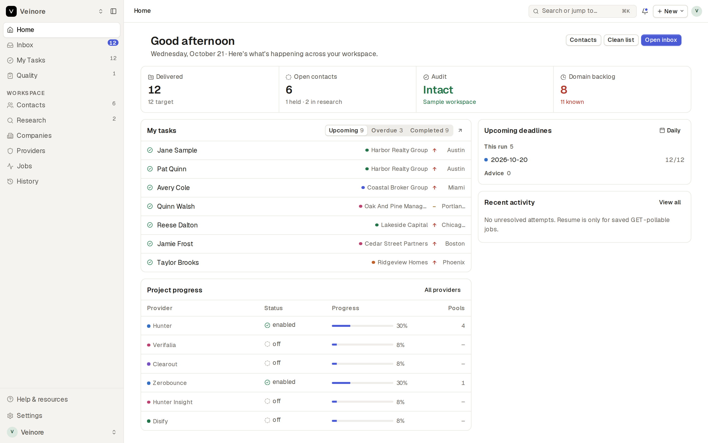
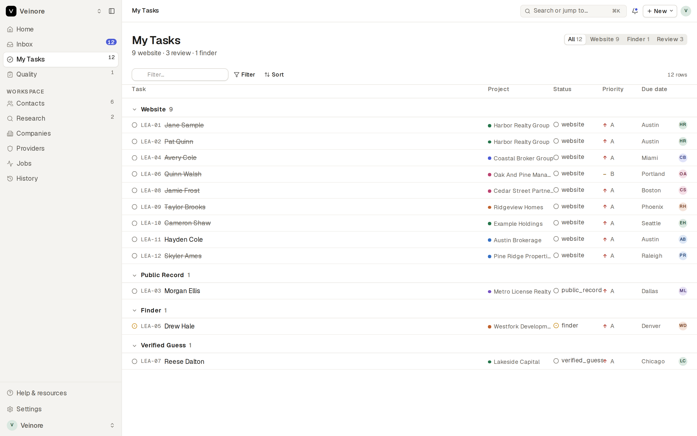
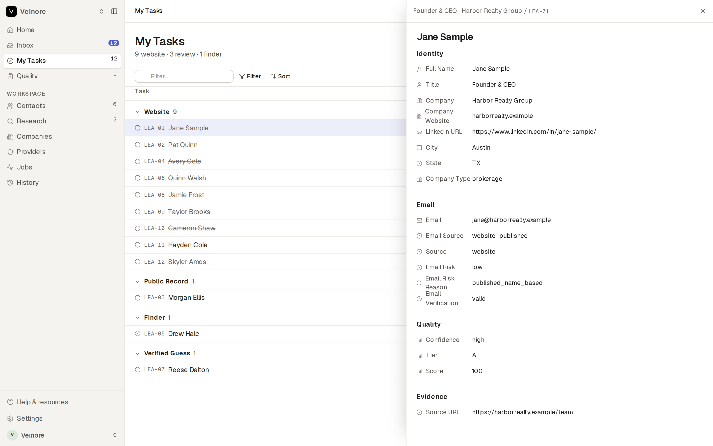
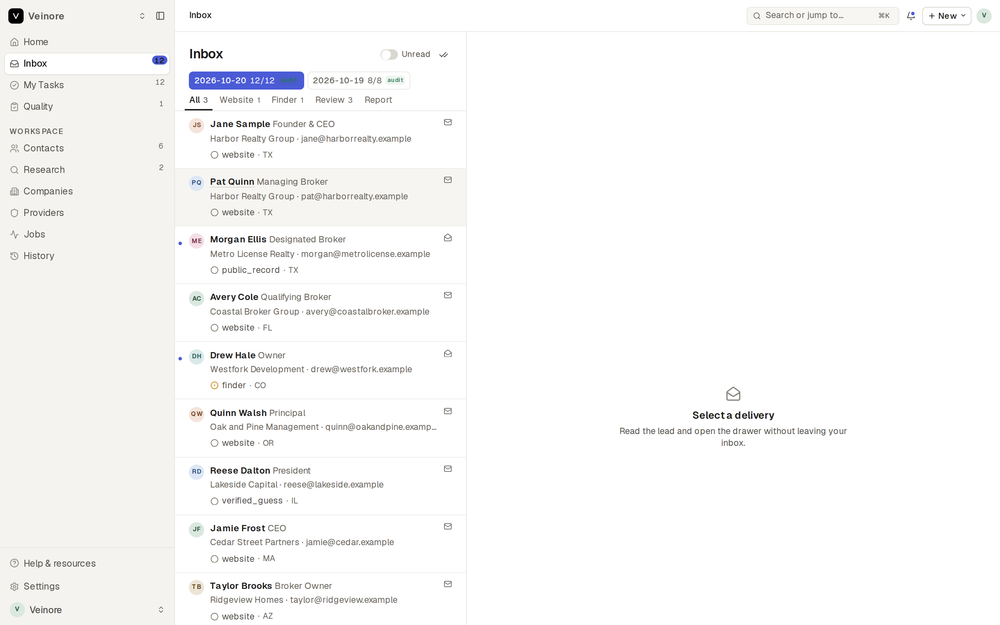
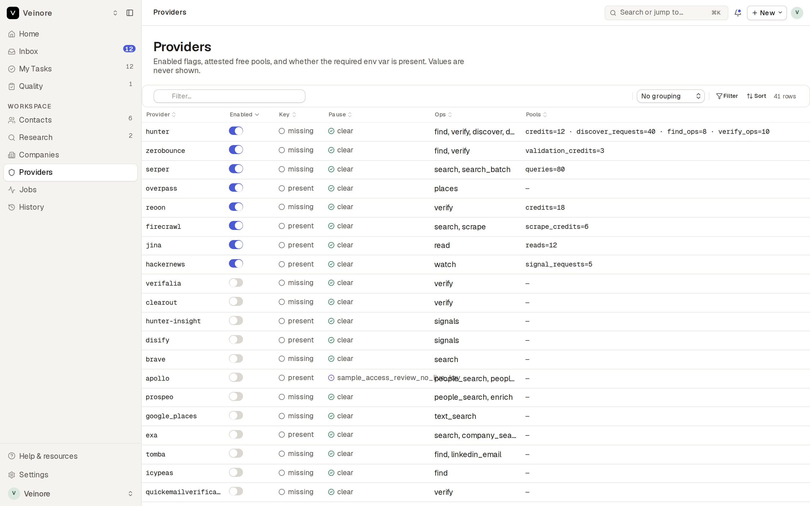
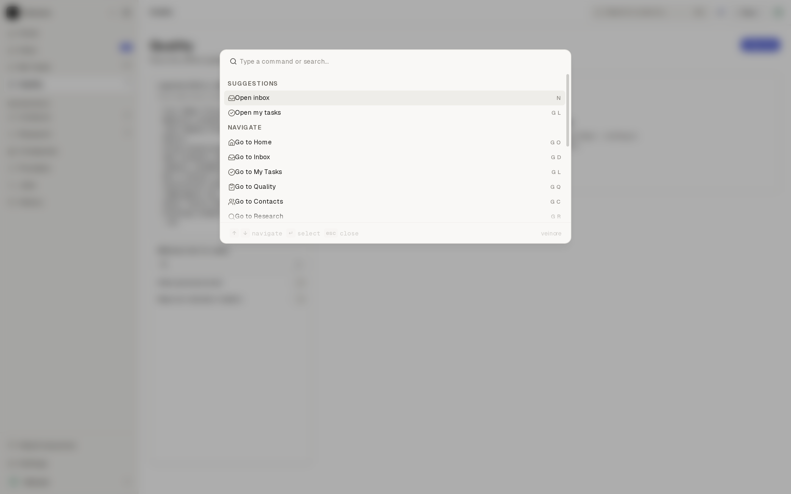

<p align="center">
  
</p>

# Veinore

Evidence-first lead research: a Python CLI and local dashboard that finds B2B contacts and work emails without mixing guesses, public sources, and provider claims.

**v0.5.0 alpha** · Python 3.11+ · zero runtime dependencies · loopback-only UI · [MIT](LICENSE)

Synthetic `example.org` / `.example` fixtures only. No contact database, API keys, or live account state ships in this repository.

## Screenshots

Synthetic sample workspace (light theme, GR8R-style chrome). No real people or keys.

| Overview | Leads |
|---|---|
|  |  |

| Lead detail | Inbox |
|---|---|
|  |  |

| Providers | Command palette |
|---|---|
|  |  |

## Features

- **Daily fresh leads** — public records → resolve → crawl → find → verify → 6-column CSV, never repeating delivered people
- **Evidence first** — source excerpts, person-match attestations, holds; guesses stay candidates until verified
- **Exact budgets** — providers start disabled and zero; `budget confirm` is operator attestation of free allowance
- **Dry by default** — network commands plan unless `--execute`; pauses stay until an explicit review
- **Veinore dashboard** — local GR8R-style workspace UI (coss ui) over the same Store / History / daily files; keys never leave the process environment

It does **not** send email, probe SMTP, scrape private profiles, rotate identities, or prove ownership or consent.

## Quick start

### CLI

```bash
PYTHONPATH=src python3 -m lead_research --help
PYTHONPATH=src python3 -m lead_research --workspace /private/ws init
PYTHONPATH=src python3 -m lead_research --workspace /private/ws demo --output /tmp/veinore-demo
```

Or install editable: `python -m pip install -e .` then use `lead-research`.

Daily loop:

```bash
lead-research --workspace /private/ws history import old-leads.csv
lead-research --workspace /private/ws daily --target 10                 # preview
lead-research --workspace /private/ws daily --target 10 --execute       # deliver
lead-research --workspace /private/ws daily audit --sample 20
```

A second `--execute` on the same date **merges** into that day’s `leads.csv` (dedupe) instead of overwriting. Preview folders stay separate.

Keys stay in the environment (names in [`.env.example`](.env.example)). Enable and attest before spend:

```bash
set -a; . /private/path/keys.env; set +a
lead-research --workspace /private/ws provider enable reoon
lead-research --workspace /private/ws budget confirm reoon \
  --pools '{"credits":"20"}' --source 'Own free plan' --free
```

### Dashboard

```bash
cd dashboard
npm install
npm run dev          # API :8787 + UI :3000, loopback only
```

Open http://127.0.0.1:3000. Sample mode seeds reserved example data on first load. Point Settings (or `LEAD_RESEARCH_WORKSPACE`) at a private workspace for live work.

Production-style local serve:

```bash
set -a; . /private/path/keys.env; set +a
cd dashboard && npm run build && npm start
```

Daily execute, budget confirm, and `resume --execute` stay on the CLI. See [`dashboard/README.md`](dashboard/README.md).

## Providers

All start **disabled** with **zero** budget. Free allowances change; confirm balances each run. Env names only — never commit values.

| Job | Providers | Env |
|---|---|---|
| Search / resolve | Serper, Brave, Tavily, Exa, Zenserp, Linkup, You.com, SerpApi, Firecrawl search | `SERPER_API_KEY`, `BRAVE_API_KEY`, `TAVILY_API_KEY`, `EXA_API_KEY`, `ZENSERP_API_KEY`, `LINKUP_API_KEY`, `YDC_API_KEY`, `SERPAPI_API_KEY`, `FIRECRAWL_API_KEY` |
| Company discovery | Hunter Discover, Google Places, OpenStreetMap, public records (TX/NY/CO/CT/SEC) | `HUNTER_API_KEY`, `GOOGLE_MAPS_API_KEY`, `SEC_USER_AGENT` |
| Page read / crawl | Local crawler (free), Jina Reader (keyless; optional key), Firecrawl scrape | `JINA_API_KEY` (optional), `FIRECRAWL_API_KEY` |
| Find emails | Hunter, ZeroBounce, Tomba, Icypeas, Deepline, Enrow, Lusha, Skrapp, Apify contacts | `HUNTER_API_KEY`, `ZEROBOUNCE_API_KEY`, `TOMBA_API_KEY`+`TOMBA_SECRET`, `ICYPEAS_API_KEY`, `DEEPLINE_API_KEY`, `ENROW_API_KEY`, `LUSHA_API_KEY`, `SKRAPP_API_KEY`, `APIFY_API_TOKEN` |
| Verify | Reoon, QuickEmailVerification, Abstract, Emailable, Kickbox, Bouncer, MyEmailVerifier, emailvalidation.io, EmailListVerify, Verifalia, Clearout, MillionVerifier | `REOON_API_KEY`, `QUICKEMAILVERIFICATION_API_KEY`, `ABSTRACT_EMAIL_API_KEY`, `EMAILABLE_API_KEY`, `KICKBOX_API_KEY`, `BOUNCER_API_KEY`, `MYEMAILVERIFIER_API_KEY`, `EMAILVALIDATION_API_KEY`, `EMAILLISTVERIFY_API_KEY`, `VERIFALIA_TOKEN`, `CLEAROUT_API_KEY`, `MILLIONVERIFIER_API_KEY` |
| Signals (not mailbox proof) | Hacker News Algolia (no key), Product Hunt, GitHub, Hunter Insight, DISIFY | `PRODUCTHUNT_TOKEN`, `GITHUB_TOKEN` |
| Identity enrich | People Data Labs, Apollo | `PDL_API_KEY`, `APOLLO_API_KEY` |

Adapter contracts and recovery rules: [`skills/lead-research/references/provider-operations.md`](skills/lead-research/references/provider-operations.md), [`skills/lead-research/references/recovery.md`](skills/lead-research/references/recovery.md).

## Safety

- Workspaces, SQLite ledgers, exports, and filled `.env` files stay **outside** the public tree
- Provider pauses are never cleared by budget edits; `resume` is GET-only for saved pending jobs
- Same-day re-execute merges with dedupe; it does not replay spent requests
- `scripts/release_check.py` rejects contact-like data, filled env templates, and secret-shaped literals
- Provider-valid ≠ delivery, consent, current employment, or ownership

## Development

```bash
PYTHONPATH=src python3 -m unittest discover -s tests -v
python3 scripts/release_check.py .
cd dashboard && npm run build
```

## License

[MIT](LICENSE) for this source code. Review provider terms and privacy obligations before live use. No permission is granted to redistribute third-party contact datasets or operate a hosted verifier resale service.
